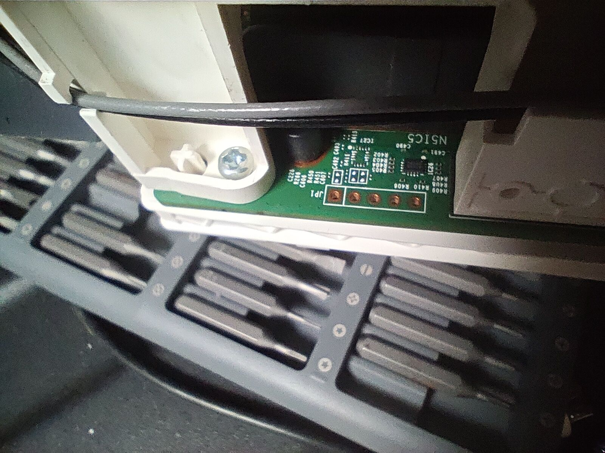

# 烽火 LG6121F OpenWrt 定制与刷写可行性

检查日期：2026-11-14。目标设备为网线及 USB 直连的 LG6121F，软件版本 RP0204T05。目标是制作 OpenWrt 类系统并保留 SIM 卡 4G/5G 上网。

## 结论

**本机原厂系统已经基于 OpenWrt，优先做保留原厂内核、驱动和 modem 配套固件的最小化定制，具有现实可行性；直接换成新版主线 OpenWrt 仍是设备适配研发，当前没有可刷且能保留蜂窝网络的成品。**

本轮已经取得临时 root Shell，确认本机分区、A/B 状态和主要驱动，完成全部 49 个 MTD 分区的电脑端备份及 SHA-256 校验，并完成 rootfs 的离线提取和重打包尺寸试验。

**仍不建议立即刷写。** 尚需确认 rootfs 验签是否强制执行、厂商 NAND 写保护的解锁方式，并实机验证 LK Fastboot/串口等低层恢复入口。当前已验证的 Telnet/ADB 都依赖系统能够正常启动，不能替代救砖通道。

### TTL好像被阉割了
主板：v3.3

元件与网上v3.0的截图相比少了一些，参考：https://www.acwifi.net/17162.html

## 1. 本机实测

| 项目 | 结果 |
| --- | --- |
| 型号 / 硬件版本 | LG6121F / WKE2.094.408A01 |
| 软件版本 | RP0204T05，COMMON / INTL |
| 原厂系统 | OpenWrt 19.07-SNAPSHOT，目标 `mt6890/evb6890v1_64_cpe_nand` |
| 内核 | Linux 4.19.205-svn190213，aarch64 |
| SoC / CPU | MediaTek MT6890，4 核 Cortex-A55 |
| 内存 | 网页字段标称 1 GiB；Linux `MemTotal=641396 kB`，其余包含 modem 等预留内存 |
| 当前槽位 | B；内核参数为 `bootslot=b`、`ubi.mtd=42` |
| 临时 Shell | Telnet 登录后已取得 `uid=0(root)`；本轮备份持续使用该入口 |
| USB ADB | 已重新实测设备在线，`adb shell id` 返回 root |
| 根文件系统 | 只读 SquashFS + 已启用的 overlayfs；overlay 约 15 MiB 可用 |
| 设备树 | 已从 `/sys/firmware/fdt` 保存，大小 152,026 字节 |

主要原始记录：

- `backups/20261114-084624/metadata/system.txt`
- `backups/20261114-084624/metadata/drivers.txt`
- `backups/20261114-084624/metadata/recovery.txt`
- `backups/20261114-084624/metadata/usb-verified.txt`

## 2. NAND、UBI 与 A/B 启动

### NAND 参数

- 49 个 MTD 分区，分区数据总容量 1,072,168,960 字节（约 1022.5 MiB）。
- 页大小 4096 字节，OOB 64 字节，物理擦除块 262,144 字节。
- ECC 强度为每 512 字节 12 bit；初始 sysfs 检查未报告坏块。
- 备份时必须保留页序、OOB、坏块和 ECC 信息，不能把普通文件复制等同于 NAND 镜像备份。

### 分区布局要点

| 类型 | 分区 |
| --- | --- |
| 启动与配置 | `preloader` mtd0、`preloader_backup` mtd1、`misc` mtd3、`seccfg` mtd14、`boot_para` mtd15 |
| 校准及厂商数据 | `proinfo`、`nvcfg`、`nvdata`、`nvram`、`protect1/2` 等 |
| A/B modem 与协处理器 | `mcf1/2`、`md1img`、`md1dsp`、`spmfw`、`pi_img`、`dpm`、`medmcu`、`sspm`、`mcupm` |
| A/B 启动链 | `lk_a/b` mtd25/38、`tee_a/b` mtd26/39、`boot_a/b` mtd27/40 |
| A/B rootfs | `rootfs_sig_a/b` mtd28/41、`rootfs_a/b` mtd29/42 |
| 数据 | `user_data` mtd48，包含 `customer`、`fhdata`、`user_data` UBI 卷 |

完整编号和容量见 `metadata/mtd-sysfs.txt` 及备份 `manifest.json`。

### 当前 rootfs 容器

- 当前 `rootfs_b` 是 UBI 镜像，LEB 为 253,952 字节。
- `ubi0` 有 `rootfs` 和 `rootfs_data` 两卷；`rootfs` 为 158 LEB，即 40,124,416 字节。
- 当前 B 槽 SquashFS 实际约 39,992,041 字节，原卷只剩约 129 KiB 余量。
- `user_data` 使用另一个 UBI 设备，包含约 100 MiB `customer`、20.1 MiB `fhdata` 和 303.7 MiB `user_data` 卷。

### bootctrl 实测

`misc` 偏移 `0x800` 处保存启动控制数据，四个 256 KiB 位置的副本一致：

- A：优先级 14，retry 0，success 1。
- B：优先级 15，retry 0，success 1。

这证明本机确有 A/B 状态管理，但不证明任意启动失败都会自动回退。A/B 两槽的 LK、boot、modem、rootfs 和 rootfs_sig 镜像均不相同，后续不能跨槽混用或假定内容一致。

## 3. 驱动与蜂窝网络结论

| 功能 | 本机证据 | 对替换系统的影响 |
| --- | --- | --- |
| Wi-Fi | PCIe 设备 `14c3:7915`，绑定 `mt_drv`；加载 `mt_wifi`、`mtk_warp` | 芯片是 MT7915，主线 `mt76` 有潜在基础，但本机 DT、校准和专有加速不能直接照搬 |
| 蜂窝控制 | 大量 `/dev/ccci_*`，`ccci_mdinit`、`ccci_fsd`、RIL 服务 | 需要保留 CCCI 内核接口、用户态服务和 modem 固件的配套关系 |
| 蜂窝数据 | `DPMAIF`、`ccmni0..20` | 本机不是已加载 `t7xx` 的普通 PCIe modem 路径，不能靠 `kmod-mtk-t7xx` 推定可用 |
| 网口 | `mtk_soc_eth`，eth0/eth1 | 主线需要 MT6890 对应平台支持及本机 PHY/DT 配置 |
| 硬件加速 | `hw_nat`、`mtk_warp`、`fhdrv_net_*` 等闭源模块 | 替换内核后不能保证性能和功能等价 |
| USB | ConfigFS gadget，RNDIS + ADB + ACM；`adbd_usb` | 已提供第二条正常系统访问路径，但不是预启动刷机证明 |

蜂窝版本字段中的 RG500L 不能改变上述实测：本机 Linux 数据面直接依赖 MT6890 的 CCCI/DPMAIF 栈。完全替换内核时，蜂窝功能是最大的兼容性障碍之一。

## 4. 原厂备份及校验

备份目录：

`backups/20261114-084624/`

结果：

- **49/49 个 MTD 分区已完成。**
- 每个分区均保存 `ecc-oob.bin`，并拆分出 `data.bin` 与 `oob.bin`。
- 每次传输都比较设备端和电脑端 SHA-256；全部匹配。
- 最后又执行 `sha256sum -c SHA256SUMS`，150 个文件条目全部通过。
- `manifest.json` 保存分区参数、镜像大小、哈希、采集时间和 ECC 警告。
- 没有遗留 `.partial` 文件。

### expdb 例外

`mtd5 expdb` 报告 449 页 ECC 不可纠正，对应区域包含实际数据，不能当作全 `0xFF` 空白页忽略。因此额外完成了 `--noecc` 原始读取：

- ECC 与 no-ECC 两份读取逐字节一致，SHA-256 相同。
- 原始镜像、日志和错误位置均已保留。
- 这提高了可重复读取的可信度，但不代表这些页的 ECC 状态正常，也不代表已做写回测试。

### 备份边界

- 这是运行中逐个分区读取，不是原子快照；YAFFS/UBIFS 可写分区在采集期间可能发生应用层变化。
- SHA-256 匹配证明传输和落盘一致，不证明恢复镜像能被设备接受。
- data-only 文件适合离线分析；raw/OOB 的写回格式、坏块处理及 ECC 布局仍需单独验证，不能直接套用通用 `nandwrite` 命令。
- 备份包含校准、NVRAM 和设备专属数据，目录权限已为仅当前用户可访问；应再保存一份离线副本并限制分发。

## 5. 恢复入口验证状态

| 入口 | 当前状态 | 能覆盖的故障 |
| --- | --- | --- |
| Telnet root | **已实测** | 正常系统内的配置或分区恢复 |
| USB ADB root | **已实测，独立于 LAN** | 正常系统仍可启动、USB gadget 正常时的恢复 |
| A/B 回退 | bootctrl 和槽位链接已确认；未制造失败启动 | 可能恢复单槽系统故障，可靠性未实测 |
| LK Fastboot / Recovery | 在 LK 二进制中找到菜单和命令实现 | 仅为候选低层入口；按键触发、USB 枚举、可执行命令和写权限未实测 |
| 串口 | 系统配置为 `ttyS0 921600`，LK 也有启动代码 | 尚未拆机或接串口，不能视为已验证 |
| Web/sysupgrade | 找到升级脚本及 gzip 魔数检查 | 不是 raw NAND 恢复入口；Web 层额外检查和签名接受条件未验证 |

LK 中还有 `load rootfs_sig`、证书链验证及 `ROOTFS_SIG_VFY Success/Fail` 路径；`rootfs_sig` 分区首 4 KiB 含实际 `cert1` 数据。**这证明存在验签实现，但尚不能仅凭字符串判断本机是否强制执行。**

因此，当前可以称为“已验证正常系统恢复通道”，不能称为“已验证救砖方案”。在未实测低层入口前，不应同时改动两槽，更不应动 preloader。

## 6. 离线制作试验

已从 A/B rootfs 的 UBI 数据中提取 SquashFS，当前 B 槽可枚举 5,515 个 inode，文件、符号链接及设备节点均可识别。

对未修改的 B 槽 rootfs 做了两次本机重打包：

| 参数 | 生成文件大小 | 相对 40,124,416 字节原 UBI rootfs 卷 |
| --- | ---: | ---: |
| XZ、256 KiB 块、无 xattr、默认过滤器 | 40,280,064 字节 | **超出 155,648 字节，不可直接写回** |
| XZ、256 KiB 块、ARM64 BCJ 过滤器 | 38,785,024 字节 | **剩余 1,339,392 字节** |

ARM64 版本保留了 5,515 个 inode 和 1 个设备节点。试验文件位于 `backups/20261114-084624/analysis/`。

这说明离线解包、修改和尺寸可控的重打包可行；**不代表重打包镜像已通过启动、签名或硬件验证。** 若增加内容仍需重新检查尺寸，必要时调整 `rootfs/rootfs_data` 布局，而不是只比较 SquashFS 超块中的未填充大小。

## 7. 新版主线 OpenWrt 路线

现有资料仍不支持直接刷主线：

1. 当前上游 MediaTek 目标没有 MT6890 子目标或 LG6121F 设备树。
2. 找到的 LG6121F 移植仓库只是适配脚手架，首次编译、实机刷写、5G/Wi-Fi 验证均未完成，也没有 Releases。
3. 本机蜂窝数据依赖 CCCI/DPMAIF 和厂商服务，不是已有 `t7xx` 文档可以覆盖的证明。
4. Wi-Fi、以太网、NAND、启动链和硬件加速均需平台适配；即便主线 `mt76` 能驱动 MT7915，也不等于整机可用。

公开参考：

- [同型号原厂系统研究](https://codming.com/posts/fiberhome-lg6121f-5g-cpe-research/)
- [LG6121F 社区移植仓库](https://github.com/linjunyidesign/fiberhome-lg6121f-openwrt)
- [OpenWrt MediaTek 目标](https://github.com/openwrt/openwrt/blob/main/target/linux/mediatek/Makefile)
- [Linux t7xx 文档](https://github.com/torvalds/linux/blob/master/Documentation/networking/device_drivers/wwan/t7xx.rst)

## 8. 推荐实施顺序与刷写门槛

1. **先利用已启用的 overlay 做最小定制**，保留原厂内核、rootfs、modem 和两槽启动链，验证所需功能是否真的需要重打包固件。
2. **把完整备份再复制到独立介质**，保留 manifest、日志和校验文件。
3. **在可接受停机的维护窗口验证低层入口**：物理串口和 LK Fastboot 的触发、USB 枚举及只读 `getvar`；在未弄清能力前不执行 flash/erase。
4. **确认写保护与验签**：找到本机 RP0204T05 的写锁控制和 rootfs_sig 实际 enforcement；不能用“其他版本可刷”替代本机验证。
5. 如确需整镜像测试，先离线验证 UBI 布局、SquashFS 尺寸、目标槽配套 boot/modem 和签名，再只考虑非当前槽，保留当前 B 槽及低层回退路径。
6. 首次启动后逐项验证 LAN、Wi-Fi、SIM 注册、APN、4G/5G 数据、短信/语音相关服务、重启持久性和回退。

**当前 go/no-go：原厂 overlay 定制可继续；整 rootfs 制作可继续离线开发；实际 NAND 刷写仍为 no-go，直到低层恢复、写保护和验签三项得到本机验证。**
